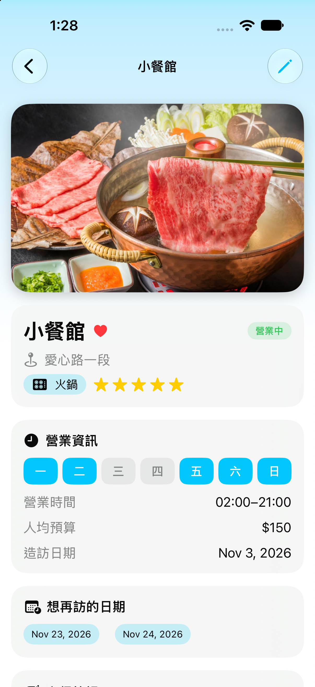

  <h1> 🍜 FoodCollection 美食收藏 </h1>
  

    
    
    
  

  
<b>一個用 SwiftUI 輸入元件打造的美食收藏 App：記錄每一間吃過的餐廳，還能換上自己喜歡的主題色 🍜🍰☕</b>

  
👉 <a href="">查看 Medium 報告</a>

---

## 📸 作品展示 (Picture)

  

## 📖 App 介紹 (Features)

1. **📋 收藏列表**
   - 用 `List` 列出所有收藏的餐廳，顯示照片、名稱、地點、評分、料理類別與營業時間。
   - 目前正在營業的餐廳會出現「營業中」標籤。
   - 點選餐廳可以查看詳細頁，包含大張照片、營業資訊、想再訪的日期與心得。
2. **➕ 新增餐廳**
   - 點右上角的 `+` 跳到新增頁，填寫名稱、地點、料理類別。
   - 營業日點選星期一到日，並用兩個滑桿調整開店與打烊時間。
   - 可以評分、設定預算、記錄造訪日期與想再訪的日期，也能選擇是否加入餐廳照片與心得筆記。
3. **✏️ 編輯與刪除**
   - 長按列表中的餐廳，會出現選單：編輯、加入最愛、刪除。
   - 編輯會帶入原本的資料；刪除會先跳出確認視窗，刪除完成後再顯示提示。
4. **🎨 主題色**
   - 主頁左上角可以用 `ColorPicker` 切換主題色，整個 App 的背景與按鈕顏色都會跟著改變，關掉 App 後也會記住。

整個 App 支援 **深色／淺色模式**，資料會存在手機裡，關掉 App 也不會消失。

## 📚 作業說明 (Assignment Details)

此為 **iOS App 程式設計課程作業** —— **「結合各種輸入元件 & 顯示 alert 的 SwiftUI APP」**。 
專案主要目標是練習使用各種輸入元件，並用 alert 提示使用者，使用的 SwiftUI 元件包含：

| 元件 | 用途 |
|---|---|
| `TextField` | 餐廳名稱、地點 |
| `Picker` | 料理類別 |
| `Slider` | 開店時間、打烊時間、好吃程度 |
| `Stepper` | 人均預算 |
| `Toggle` | 加入最愛 |
| `DatePicker` | 造訪日期 |
| `MultiDatePicker` | 想再訪的日期 |
| `TextEditor` | 心得筆記 |
| `PhotosPicker` | 餐廳照片 |
| `ColorPicker` | 主題色 |
| `contextMenu` | 長按列表：編輯、加入最愛、刪除 |
| `alert` | 新增成功、更新成功、刪除確認、刪除成功、欄位未填提醒 |

以及一些課程講義外或之前學過的學習內容，包含：
- 資料保存：`Codable` 搭配 JSON 檔存放餐廳資料，`@AppStorage` 記住主題色。
- 資料更新：`@Observable` 讓資料改變時畫面自動更新。
- 導覽：`NavigationStack` 搭配 `navigationDestination(item:)`，用同一個表單頁處理新增與編輯。
- 動畫與 SF Symbol 動畫：`withAnimation`、`transition`、`symbolEffect`

📖 **Medium 文章連結：** 👉 [[點此閱讀完整心得報告]]()
